# Clean it Up! 개발 포트폴리오

## 1. 프로젝트 개요

**Clean it Up!**은 청소기 캐릭터를 조이스틱으로 이동시켜 주변 오브젝트를 수집하는 3D 캐주얼 게임이다.
한 스테이지 안에서 경험치와 골드를 얻고 성장하며, 제한시간 안에 누적 경험치 또는 특정 오브젝트 수집 목표를 달성한다. 스테이지 종료 후 골드를 상점과 영구 업그레이드에 사용한다.

개발 기간은 2025년 4월~5월, 총 2개월이다.
기획, 디자인, 프로그래밍, UI/UX 디자인 총 4명이 1개의 팀을 이루어 프로그래밍 부분을 담당했다.

핵심 반복 구조는 다음과 같다.

  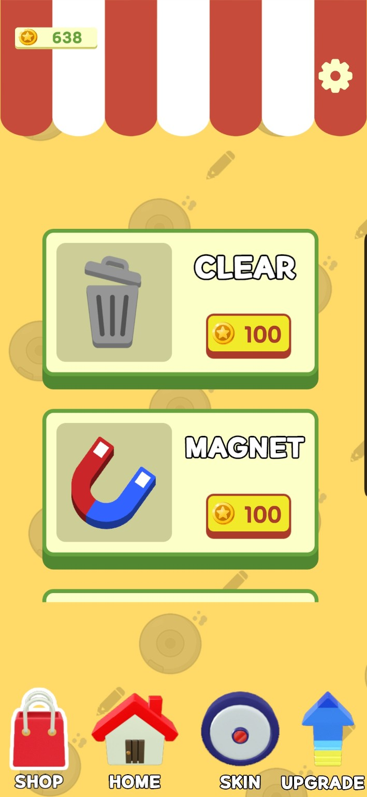 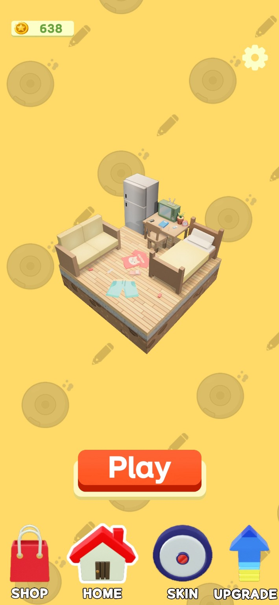 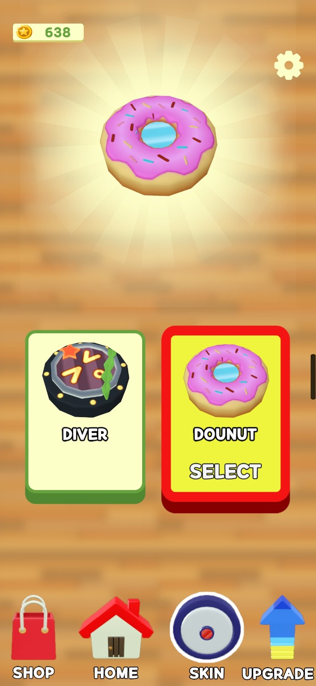 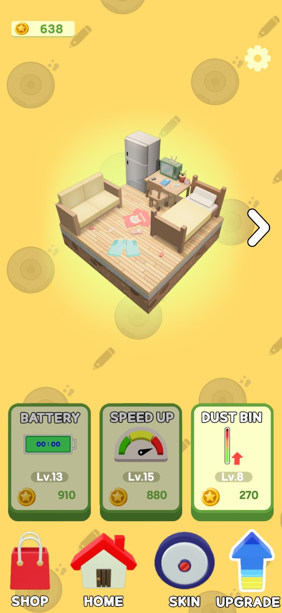
  <h2><strong>1. 메인 화면에서 스킨·아이템·업그레이드를 설정한다.</strong></h2>

---

  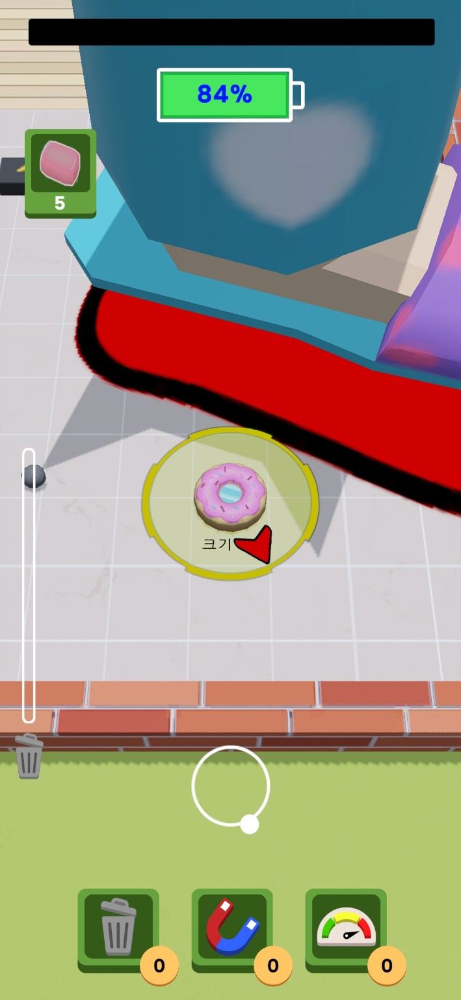 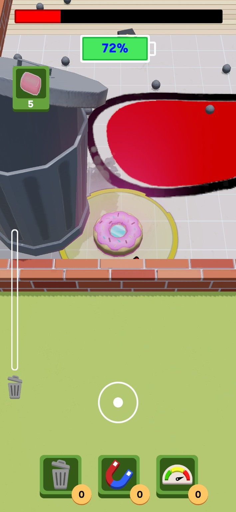 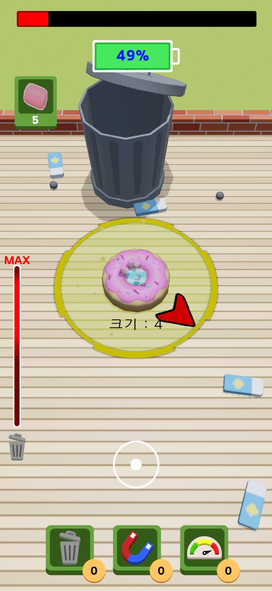
  <h2><strong>2. 현재 레벨 이하의 오브젝트를 수집해 경험치·골드를 얻으며, 쓰레기 적재량에 따른 감속을 관리하고 발 공격을 피한다.</strong></h2>

---

  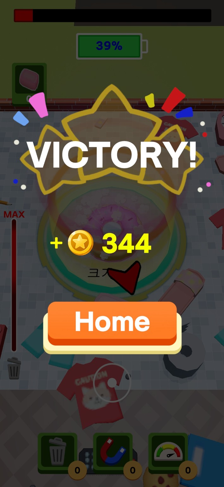 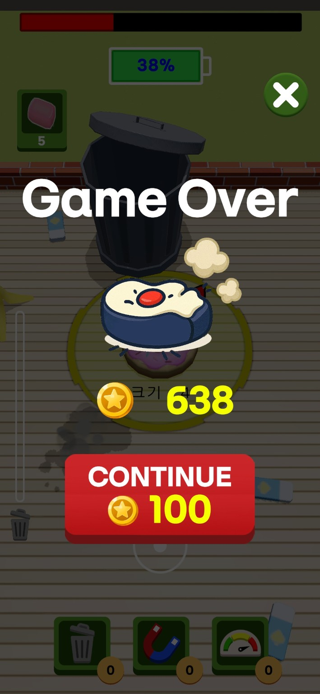 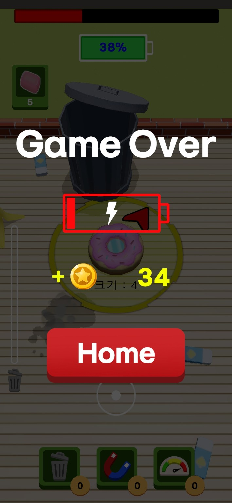
  <h2><strong>3. 목표 달성 또는 실패 시 획득 골드를 정산하고 메인 화면으로 돌아간다.</strong></h2>

---

상점·이어하기는 게임 내 골드를 사용하며, 진행 정보는 로컬 `PlayerPrefs`에 저장한다. 

### 1.1 개발 환경

| 항목 | 내용 |
| --- | --- |
| 게임 엔진 | Unity 6000.0.40f1 |
| 개발 도구 | Visual Studio 2022 |

### 1.2 씬 구성과 실행 흐름

초기화, 메인 화면, 게임 플레이를 세 개의 씬으로 구성했다.

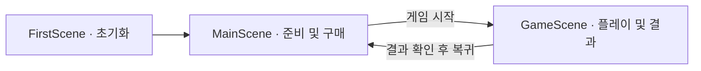

**실행은 FirstScene에서 시작한다.** 이 씬에서 `GameManager`를 초기화하고, 이후 씬에서도 플레이어의 영구 데이터를 유지한다.

## 2. 핵심 구현 사항

### 2.1 상태 관리 구조

골드·업그레이드처럼 플레이 이후에도 유지할 데이터와, 레벨·적재량처럼 한 스테이지에서 사용하는 데이터를 구분했다.

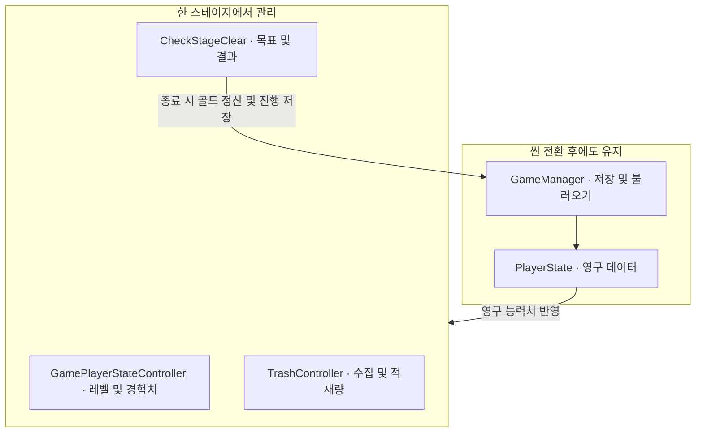

| 구분 | 주요 데이터 | 담당 구성요소 |
| --- | --- | --- |
| 영구 상태 | 골드, 업그레이드, 아이템 수량, 스테이지, 스킨, 설정 | `GameManager`, `PlayerState` |
| 플레이 중 성장 | 현재 레벨, 경험치, 이번 판 획득 골드 | `GamePlayerStateController` |
| 수집 상태 | 적재량, 수집 목표 진행도 | `TrashController` |
| 진행 및 결과 | 남은 시간, 목표 판정, 승리·실패, 정산 | `CheckStageClear` |

- `GameManager`는 싱글턴으로 접근하며, `DontDestroyOnLoad`로 씬 전환 후에도 유지한다.
- 한 판의 성장과 수집 상태는 각 담당 컴포넌트에서 관리하고, 종료 시 획득 골드와 진행 정보를 영구 상태에 반영한다.

### 2.2 입력과 캐릭터 이동

조이스틱 입력을 이벤트로 전달해 캐릭터를 이동시킨다. 수집 중에는 적재량에 따라 감속하고, 쓰레기통을 이용하면 적재량을 비우며 일시적으로 가속한다.

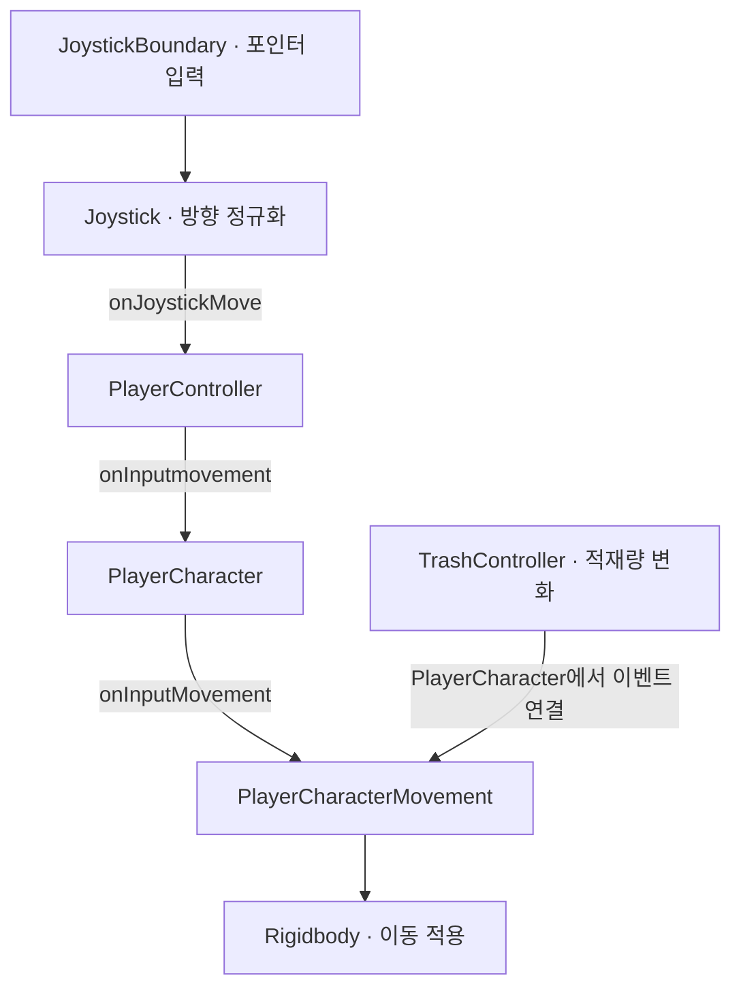

| 적재 상태 | 기본 속도 대비 이동속도 |
| --- | --- |
| 80% 미만 | 100% |
| 80% 이상, 100% 미만 | 85% |
| 100% 이상 | 70% |

- 입력 방향을 정규화해 XZ 평면에서 이동하며, 캐릭터도 이동 방향으로 회전한다. 조이스틱을 놓으면 이동 입력을 해제한다.
- 적재량 변화는 `onTrashGet`, `onTrashEmpty` 이벤트로 이동 처리에 전달한다. 적재량이 가득 차도 수집은 계속 가능하다.
- 쓰레기통에 접촉하면 적재량과 관련 UI를 초기화하고, 일반 이동 상태에서는 2초간 기본 속도의 2배로 가속한다.

### 2.3 오브젝트 수집과 성장

현재 레벨 이하의 오브젝트를 수집하면 경험치와 골드를 얻는다. 레벨이 오르면 캐릭터 크기와 카메라 높이를 함께 조정한다.

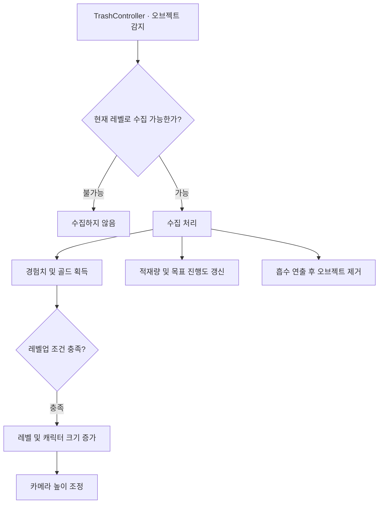

- `TrashController`는 `IObstacle`을 통해 수집 대상의 레벨을 확인하고, 수집 가능한 오브젝트에 보상·적재량·목표 갱신을 적용한다.
- 경험치와 골드는 `ObjectData`, 레벨업 기준은 `PlayerExpData`에서 참조한다.
- 수집 대상의 콜라이더를 끈 뒤 이동·축소 연출을 실행하고 제거한다. 캐릭터 크기 변화에는 `SmoothDamp`를 사용한다.

### 2.4 스테이지 진행과 결과 처리

스테이지 목표는 누적 경험치 달성과 지정 오브젝트 수집으로 나뉜다. 목표 달성, 시간 소진, 발 충돌에 따라 결과와 이어하기를 처리한다.

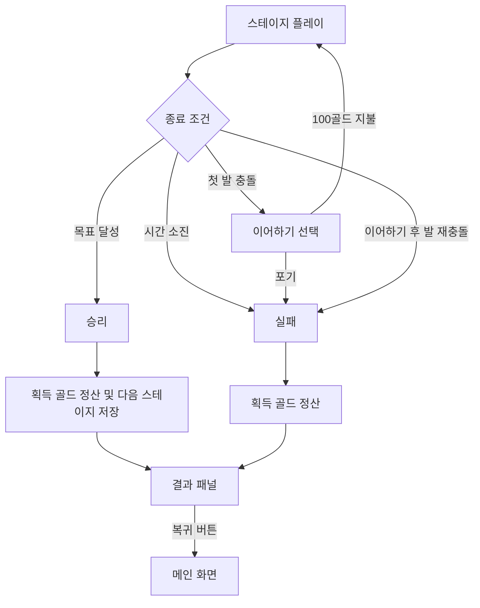

| 목표 종류 | 완료 조건 |
| --- | --- |
| 경험치 목표 | 한 판에서 수집한 경험치 합계가 목표 이상 |
| 수집 목표 | 지정된 이름의 오브젝트를 요구 수량만큼 수집 |

- 승리·실패 시 `Time.timeScale`을 0으로 설정하고 결과 패널을 표시한다. 메인 화면 복귀 시에는 1로 복원한다.
- 첫 발 충돌에서 이어하기를 선택하면 100골드를 차감하고 재개한다. 이어하기 후 다시 충돌하면 실패한다.
- 배터리 UI는 남은 시간을 백분율로 표시하며, 마지막 스테이지를 완료하면 현재 스테이지를 유지한다.

### 2.5 맵 생성과 카메라

스테이지 테마에 맞는 맵과 오브젝트를 활성화하고, 플레이어 주변에 수집 대상과 발 공격을 생성한다. 카메라는 플레이어를 추적하며 시야를 가리는 벽의 투명도를 조정한다.

| 기능 | 주요 동작 | 담당 구성요소 |
| --- | --- | --- |
| 테마 선택 | Home·Office·Park에 맞는 테마 활성화 | `SelectThema` |
| 일반 오브젝트 생성 | 주변 위치와 겹침 여부를 검사한 뒤 주기적으로 생성 | `TrashGeneratorBase` |
| 발 공격 | 플레이어 주변 바닥을 확인하고 경고 후 발 하강·상승 | `FootGenerator`, `FootController` |
| 특수 오브젝트 생성 | 테마별 지정 범위에서 특수 오브젝트 생성 | `SpecialGenerator` |
| 카메라 추적 | 플레이어 위치를 따라가며 벽 가림 여부 검사 | `SetCamera` |
| 시야 가림 처리 | 감지된 벽의 알파값 조정 및 복구 | `InvisibleWall` |

- 생성 위치는 레이어 검사로 확인한다. 일반 오브젝트는 주변 장애물과의 겹침을, 발 공격은 바닥 유무를 검사한다.
- 발 공격은 경고 표시 이후 하강·상승하도록 구성하고, 동작 완료 또는 충돌 통지 시 제거한다.
- 벽의 투명도 변화는 해당 재질의 투명 렌더링 설정과 함께 적용한다.

### 2.6 상점·업그레이드·스킨 및 저장

메인 화면에서 골드로 아이템과 영구 업그레이드를 구매하고 스킨을 선택한다. 변경된 영구 데이터는 `PlayerState`에 반영하고, 저장 대상 값은 로컬에 기록한다.

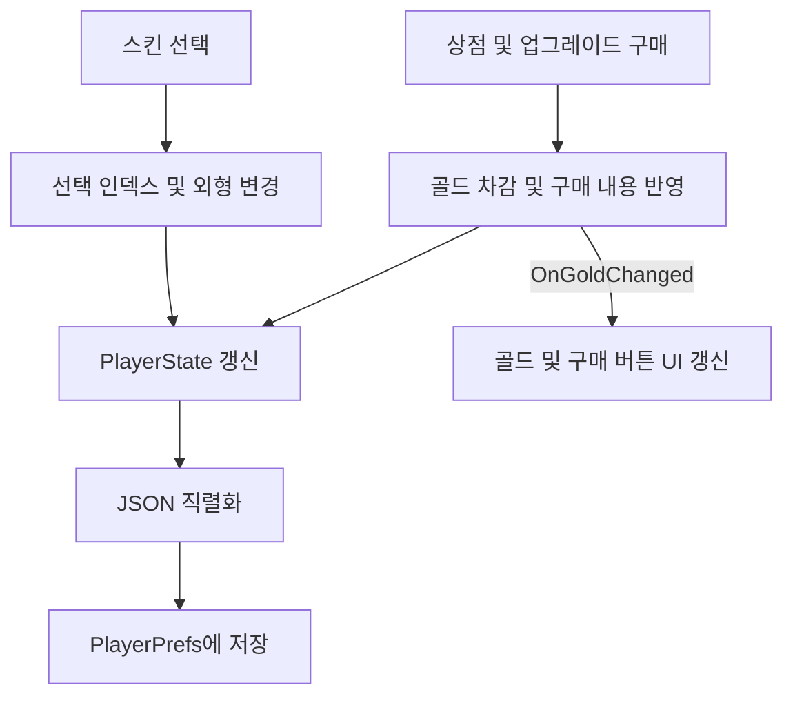

| 기능 | 효과 및 처리 |
| --- | --- |
| 영구 업그레이드 | 이동속도·제한시간·최대 적재량 강화 |
| 비우기 아이템 | 현재 적재량 초기화 |
| 자석 아이템 | 5초간 수집 영역의 크기 1.5배 |
| 속도 증가 아이템 | 5초간 기본 이동속도 1.5배 |
| 스킨 선택 | 9종의 스킨 중 선택한 Mesh와 Material 적용 |

- `MainPanelManager`가 상점·홈·스킨·업그레이드 패널을 전환한다. 업그레이드 UI는 `OnGoldChanged`를 구독해 구매 버튼 이미지를 갱신하고, 제거 시 구독을 해제한다.
- 소모품은 각각 100골드이며 사용 쿨타임은 5초다. 사용 시 보유 수량을 확인·차감하고 저장하며, 효과 시간과 쿨타임은 일시정지 중 함께 멈춘다.
- 골드·업그레이드·아이템 수량·스테이지·스킨 변경은 setter에서 저장한다. 기본 능력치와 진동·BGM·SFX 설정은 setter에서 즉시 저장하지 않는다. 저장 형식은 JSON이며 `PlayerPrefs`의 `PlayerState` 키를 사용한다.

## 3. 문제 해결 사례

### 3.1 벽에 가려지는 청소기 시야 확보

- **문제:** 청소기와 카메라 사이의 벽이 시야를 가려 청소기의 위치와 이동 방향을 확인하기 어려웠다.
- **해결:** Raycast로 시야를 가리는 벽을 감지하고, 해당 Material의 알파값을 낮춰 반투명하게 표시했다.
- **결과:** 벽 뒤에서도 청소기를 확인할 수 있어 이동 중 시야를 확보했다.

### 3.2 접근할 수 없는 위치의 쓰레기 생성 방지

- **문제:** 벽 너머의 이동 불가능한 영역에 쓰레기가 생성되어 수집할 수 없었다.
- **해결:** 생성 후보 위치에서 아래로 Raycast를 쏴 이동 가능한 바닥인지 검사하고, 유효한 위치에만 쓰레기를 생성했다.
- **결과:** 접근할 수 없는 위치에 쓰레기가 생성되는 것을 방지해 정상적으로 수집할 수 있도록 했다.
