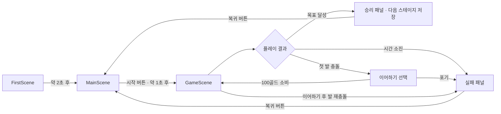
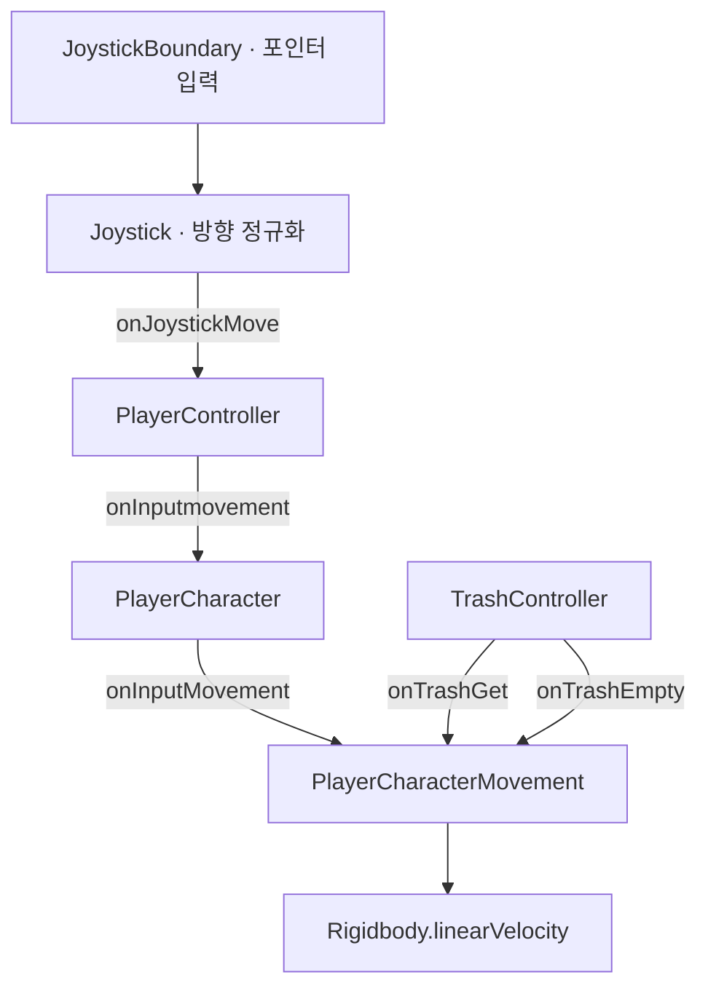

# Clean it Up! 기술문서

## 1. 프로젝트 개요

**Clean it Up!**은 청소기 캐릭터를 조이스틱으로 이동시켜 주변 오브젝트를 수집하는 3D 캐주얼 게임이다.
한 스테이지 안에서 경험치와 골드를 얻고 성장하며, 제한시간 안에 누적 경험치 또는 특정 오브젝트 수집 목표를 달성한다. 스테이지 종료 후 골드를 상점과 영구 업그레이드에 사용한다.\n개발 기간은 25년 4월 ~ 25년 5월 총 2개월동안 진행했다.
기획, 디자인, 프로그래밍, UI/UX 디자인 총 4명이 1개의 팀을 이루어 프로그래밍 부분을 담당했다.

핵심 반복 구조는 다음과 같다.


1. 메인 화면에서 스킨·아이템·업그레이드를 설정한다.

2. 현재 스테이지의 테마와 목표로 게임을 시작한다.

3. 현재 레벨 이하의 오브젝트를 수집해 경험치·골드를 얻는다.

4. 쓰레기 적재량에 따른 감속을 관리하고 발 공격을 피한다.

5. 목표 달성 또는 실패 시 획득 골드를 정산하고 메인 화면으로 돌아간다.

상점·이어하기는 게임 내 골드를 사용하며, 진행 정보는 로컬 `PlayerPrefs`에 저장한다. 

## 2. 개발 환경 및 의존성

| 항목 | 저장소 설정 |
| --- | --- |
| Unity Version | 6000.0.40f1 |
| IDE | Visual Studio | 2022 |

## 3. 씬 구성과 실행 흐름

빌드 설정에 활성화된 씬은 아래 순서다.

| 인덱스 | 씬 | 책임 |
| --- | --- | --- |
| 0 | `FirstScene` | GameManager 초기화, 초기 로딩 표시 |
| 1 | `MainScene` | 홈·상점·스킨·업그레이드·설정 화면 |
| 2 | `GameScene` | 테마 선택, 플레이, 목표·실패 판정, 결과 표시 |



`GameManager`는 `FirstScene`에 연결되어 있으며 `DontDestroyOnLoad`로 유지된다. 메인·게임 씬의 여러 `Awake`가 `GameManager.Instance.playerState`를 바로 참조하므로 **정상 진입점은 FirstScene**이다. 다른 씬을 직접 재생하면 매니저 누락으로 예외가 발생할 수 있다.

## 4. 런타임 아키텍처

### 4.1 영구 상태와 한 스테이지 상태

| 구성요소 | 책임·수명 |
| --- | --- |
| `GameManager` | 싱글턴, 저장 불러오기·쓰기, 씬 전환 후에도 유지 |
| `PlayerState` | 골드, 업그레이드 단계, 아이템 수량, 현재 스테이지·스킨, 설정 값 |
| `GamePlayerStateController` | 한 판의 레벨, 경험치, 획득 골드, 성장 크기 |
| `TrashController` | 적재량, 목표 수집 진행도, 오브젝트 감지·수집 |
| `CheckStageClear` | 시간, 목표 데이터 초기화, 승리·실패 패널 및 정산 |

### 4.2 입력·이동 이벤트 경로



`JoystickBoundary`는 누른 위치로 조이스틱을 옮기고 입력을 전달한다. `Joystick`은 방향을 정규화하므로 드래그 거리로 이동속도를 조절하지 않는다. 버튼을 떼면 영벡터를 전달한다. 이동은 XZ 평면에서 수행하고 입력 방향으로 캐릭터를 회전시킨다.

`PlayerCharacter`는 적재량 변화에 따른 감속과 쓰레기통 비우기 후 가속 이벤트도 연결한다. 입력 이벤트 구독은 주로 `Start`, 상태 초기화는 주로 `Awake`에서 수행된다.

## 5. 인게임플레이 상세

### 5.1 오브젝트 수집과 성장

+ 실행환경 이미지

`TrashController.OnTriggerStay`는 `Obstacle` 태그를 가진 콜라이더에서 `IObstacle`을 얻는다. `CheckLevel(playerLevel)`이 `true`이면 오브젝트 레벨이 더 높다는 의미로 수집을 건너뛴다. 수집 가능한 경우 목표 진행도, 경험치·골드, 흡수 연출, 적재량을 처리한다.

`ObstacleBase`의 주요 규칙은 다음과 같다.

- 경험치: `ObjectData.exp[obstacleLevel - 1]`.
- 골드: 레벨 1~2는 `gold[0]`, 3~4는 `gold[1]`, 5~6은 `gold[2]`, 7~13은 `gold[3]`~`gold[9]`, 나머지는 `gold[10]`.
- `obstacleName == "Special"`이면 골드는 1,000.
- 흡수당할 시 콜라이더를 즉시 끄고, 오브젝트를 이동·축소한 뒤 0.3초 후 **부모 GameObject**를 제거한다.

현재 `ObjectData`에는 경험치 14개(10~140), 골드 11개(1~100)가 있다. 오브젝트 프리팹은 삭제할 단위를 부모로 두는 계층 구조를 유지해야 한다.

`GamePlayerStateController`는 레벨 1·경험치 0에서 시작한다. 수집할 때 골드와 경험치를 더하고 설정값을 넘으면 한 번 레벨업한다. 레벨업마다 목표 크기가 각 축 0.5씩 커지고 카메라 높이는 4씩 증가한다. 크기는 `SmoothDamp`로 보간한다. `PlayerExpData.maxExp`는 20개이며 첫 설정값은 30, 마지막은 19,964다.

### 5.2 적재량과 이동속도

+ 실행환경 이미지

```text
기본 이동속도 = PlayerState.moveSpeed × UpgradeData.moveSpeed[이동 업그레이드 단계]
최대 적재량   = UpgradeData.maxTrash[적재량 업그레이드 단계]
제한시간      = UpgradeData.limitTime[시간 업그레이드 단계]
적재 비율     = 내부 적재량 / 최대 적재량
```

'`Obstacle`오브젝트 하나당 내부 적재량은 **5** 증가한다. 적재량 UI 비율은 최대 1로 제한하지만 내부 적재량은 계속 증가할 수 있고, 적재량이 가득 찬 상태에서도 수집을 막는 조건은 없다.

| 적재 상태 | 이동속도 |
| --- | --- |
| 80% 미만 | 기본 속도의 100% |
| 80% 이상, 100% 미만 | 기본 속도의 85% |
| 100% 이상 | 기본 속도의 70% |

`Trashcan`은 `Player` 태그와 충돌하면 자식의 `ITrashReset.resetTrash()`를 호출한다. 적재량과 관련 UI·파티클을 초기화하고, 일반 이동 상태라면 **2초간 기본 속도의 2배**로 가속한다.

### 5.3 목표·종료·정산
`StageType`은 `Exp = 0`, `Target = 1`이다.

| 종류 | 완료 조건 |
| --- | --- |
| Exp | 판 전체에서 수집한 경험치 합계 `TotalTrash`가 목표 이상 |
| Target | `GetName()`이 목표 이름과 일치하는 오브젝트의 남은 수량이 0 |

+ 실행환경 이미지

목표 달성 시 `Time.timeScale = 0`, 다음 스테이지 저장(마지막이면 유지), 획득 골드 합산, 승리 패널 표시를 수행한다. 메인 씬으로 자동 이동하지 않는다.

+ 실행환경 이미지

시간은 매 프레임 감소하며 0 미만이 되면 멈추고 실패 패널을 표시하고 획득 골드를 합산한다.

+ 실행환경 이미지

배터리 UI는 초 대신 남은 시간의 백분율을 표시한다.

+ 실행환경 이미지

발 충돌 시 첫 번째는 이어하기 패널을 표시한다. 100골드 이상 보유하고 있다면 골드를 차감하고 재개할 수 있으며, `PlayerCharacter`가 한 번의 기회를 소진한다.

+ 실행환경 이미지

이후 발 충돌은 바로 실패 처리한다.

메인 복귀는 `Time.timeScale`을 1로 되돌리고 1초 대기한 뒤 수행한다.

### 5.4 생성기와 카메라

| 구성요소 | 동작 |
| --- | --- |
| `SelectThema` | 스테이지 데이터의 Home·Office·Park에 맞는 테마 오브젝트 활성화 |
| `TrashGeneratorBase` | 생성기 주변 X/Z -9~9 범위에서 위치 선택, Obstacle 레이어 SphereCast 후 12초 간격 생성 시도, 생성물은 20초 뒤 제거 |
| `FootGenerator` | 플레이어 반경 10 안에서 Floor 레이어 검사 후 테마별 발 생성, 성공 후 간격 3~4.5초 |
| `FootController` | 약 1.5초 경고 표시 후 발 하강·상승, 상승 완료 또는 충돌 통지 시 제거 |
| `SpecialGenerator` | 테마별 고정 좌표 범위에서 특수 오브젝트 한 개 생성 |
| `SetCamera` | 플레이어 추적, 초기 높이 18, Wall 레이어 가림 검사 |
| `InvisibleWall` | 카메라 가림 감지 시 재질 알파를 조정하고 마지막 요청 후 약 0.5초 뒤 복구 |

일반 생성기의 프리팹 배열은 레벨 그룹별 누적 개수(`LevelOne`~`LevelFour`)와 순서가 일치해야 한다. 특수 오브젝트의 위치 범위는 스크립트에 직접 들어 있으므로 맵 위치를 변경하면 함께 검토한다. 벽 투명화는 재질의 투명 렌더링 설정에 따라 실제 표시 결과가 달라질 수 있다.

## 6. 메인 화면·경제·아이템
`MainPanelManager`는 Inspector 배열 인덱스 0=상점, 1=홈, 2=스킨, 3=업그레이드로 패널과 선택 이미지를 전환한다. 초기 화면은 홈이다.

### 6.1 업그레이드

+ 실행환경 이미지

`UpgradeBase`의 하위 클래스는 이동속도·시간·적재량 업그레이드를 구분한다. 비용은 이동·적재량이 `upgradeMoney[level + 1]`, 시간이 `upgradeMoney_LimitTime[level + 1]`이다. 구매 시 골드를 차감하고 영구 단계와 관련 UI를 갱신한다. `OnGoldChanged`를 구독해 버튼 이미지를 변경하고 `OnDestroy`에서 구독을 해제한다.

### 6.2 상점
| 소모품 | 구매 가격 | 효과 | 사용 제한 |
| --- | --- | --- | --- |
| 비우기 | 100골드 | 현재 적재량 초기화 | 5초 쿨타임 |
| 자석 | 100골드 | 수집 영역 로컬 스케일 1.5배, 5초 후 1로 복구 | 5초 쿨타임 |
| 속도 증가 | 100골드 | 기본 이동속도 1.5배, 5초 | 5초 쿨타임 |

+ 실행환경 이미지

소모품은 `UI_BuyItem`에서 구매하고 각 `Item_*` 컴포넌트에서 보유 수량을 확인·차감·저장한다. 효과 시간과 쿨타임은 `WaitForSeconds`·`Time.deltaTime`에 의존하므로 일시정지 중 함께 멈춘다.

### 6.3 스킨

+ 실행환경 이미지

`MainSkin`은 Basic, Devil, Diver, Donut, Duck, Future, Heart, Space, Tiger의 9가지 선택 함수를 제공한다. `SetSkin`은 저장된 인덱스로 `SkinData`의 Mesh와 Material을 적용한다.

## 7. 저장과 설정

저장 경로는 Unity `PlayerPrefs`, 키는 **`PlayerState`**, 값은 `JsonUtility.ToJson(playerState)`의 JSON 문자열이다. `SavePlayerState`는 `SetString` 후 `PlayerPrefs.Save()`를 호출한다.

신규 상태의 초기값은 골드 1,000, 기본 속도 6, 기본 적재량 필드 75, 기본 시간 필드 40, 업그레이드 단계·스테이지·스킨 0, 소모품 수량 0이다.

| 변경 종류 | setter에서 즉시 저장 |
| --- | --- |
| 골드 | 예, `OnGoldChanged` 호출 후 저장 |
| 업그레이드 단계·아이템 수량·스테이지·스킨 | 예 |
| 기본 속도·적재량·시간 | 아니오 |
| 진동·BGM·SFX 설정 | 아니오 |

## 8. 확장 작업 가이드

### 8.1 스테이지 추가

1. `StageGoalData.asset`의 배열에 목표 종류·테마·목표값·이미지를 추가한다.
2. Target 이름을 프리팹의 `obstacleName`과 대소문자까지 동일하게 지정한다.
3. 해당 테마에 목표 오브젝트가 실제 배치되거나 생성되는지 확인한다.
4. `MainHome`의 79 하드코딩과 스테이지 선택 UI 범위를 새 배열 길이에 맞춘다.
5. 저장된 `currentStage` 범위, 마지막 스테이지 유지 동작을 확인한다.

### 8.2 수집 오브젝트 추가

1. 부모 아래 수집용 자식·Collider·ObstacleBase를 구성한다.
2. 태그·레이어·이름·레벨·ObjectData 참조를 지정한다.
3. 경험치·골드 배열의 유효 범위와 현재 보상 매핑을 확인한다.
4. 생성기 배열의 그룹 순서와 누적 개수를 함께 수정한다.

### 8.3 능력치·테마·스킨 추가

- 업그레이드 수를 변경하면 모든 능력치·비용 배열과 코드 상한을 함께 변경한다.
- 새 테마는 enum, 각 선택 switch, 배열 순서, 맵 배치, 특수 오브젝트 좌표를 함께 확장한다.
- 새 스킨은 데이터·버튼·미리보기 인덱스와 선택 함수를 함께 추가한다.
- 저장 필드를 변경할 때 기본값·구버전 JSON·인덱스 검증·저장 시점을 함께 정의한다.