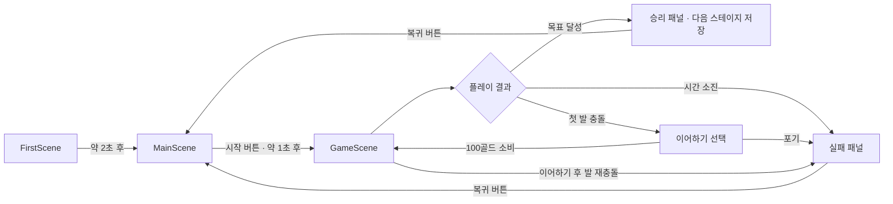
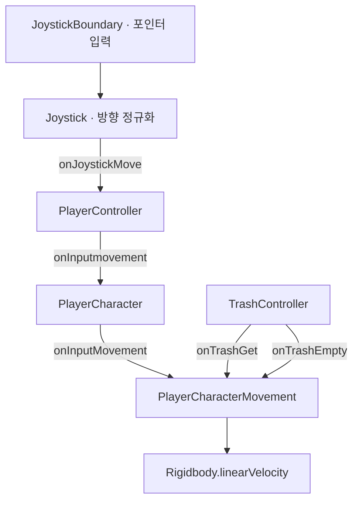

# Clean it Up! 기술문서

작성일: 2026-10-19  
대상: 현재 작업 디렉터리의 C# 코드, Unity 씬·에셋 및 프로젝트 설정  
독자: 프로젝트 인수인계 담당자, Unity 개발자, 콘텐츠·밸런스 담당자

> 이 문서는 커밋된 코드뿐 아니라 작성 시점의 로컬 변경 사항을 포함한 정적 분석 결과다. Unity Editor에서의 실행, Android 빌드 및 실기기 검증은 수행하지 않았다. 아래의 실제 동작과 잠재 오류를 구분해 읽어야 한다.

## 1. 프로젝트 개요

**Clean it Up!**은 청소 캐릭터를 조이스틱으로 이동시켜 주변 오브젝트를 수집하는 3D 캐주얼 게임이다. 한 판 안에서 경험치와 골드를 얻고 성장하며, 제한시간 안에 누적 경험치 또는 특정 오브젝트 수집 목표를 달성한다. 판 종료 후 골드를 상점과 영구 업그레이드에 사용한다.

핵심 반복 구조는 다음과 같다.

1. 메인 화면에서 스킨·아이템·업그레이드를 설정한다.
2. 현재 스테이지의 테마와 목표로 게임을 시작한다.
3. 현재 레벨 이하의 오브젝트를 수집해 경험치·골드를 얻는다.
4. 쓰레기 적재량에 따른 감속을 관리하고 발 공격을 피한다.
5. 목표 달성 또는 실패 시 획득 골드를 정산하고 메인 화면으로 돌아간다.

사용자 정의 스크립트에서는 서버 통신, 계정 인증, 광고 SDK 또는 실제 결제 연동을 확인하지 못했다. 현재 확인된 상점·이어하기는 게임 내 골드를 사용하며, 진행 정보는 로컬 `PlayerPrefs`에 저장한다. 패키지의 설치 여부만으로 해당 기능이 구현되었다고 볼 수는 없다.

## 2. 개발 환경 및 의존성

| 항목 | 저장소 설정 |
| --- | --- |
| Unity Editor | `6000.0.40f1` |
| 언어·구조 | C#, MonoBehaviour 컴포넌트 조합 |
| 렌더링 | Universal Render Pipeline `17.0.4` |
| UI | uGUI `2.0.0`, TextMeshPro 사용 |
| 입력 패키지 | Input System `1.13.0`; 실제 이동 입력은 uGUI 포인터 이벤트 기반 |
| 입력 처리 설정 | `activeInputHandler: 2` |
| 테스트 패키지 | Unity Test Framework `1.4.6` |
| 기타 주요 패키지 | AI Navigation `2.0.6`, Timeline `1.8.7`, Visual Scripting `1.9.5` |
| 제품명 / 회사명 | `Clean it Up!` / `GAC` |
| 애플리케이션 버전 | `0.1.0` |
| Android 설정 | 최소 API 23, 대상 API 자동 설정(`0`), ARM64(`2`), IL2CPP(`1`) |

버전 근거는 `ProjectSettings/ProjectVersion.txt`, `Packages/manifest.json`, `ProjectSettings/ProjectSettings.asset`이다. 이 표는 저장된 설정이며, 현재 배포 플랫폼의 요구사항 충족 여부나 빌드 성공을 의미하지 않는다.

## 3. 디렉터리 구조

```text
Assets/
  Scenes/                 FirstScene, MainScene, GameScene, Test
  Scripts/
    GameManager.cs        씬 간 유지되는 전역 상태·저장
    PlayerState.cs        영구 플레이어 데이터
    FirstLoading.cs       첫 화면에서 메인 화면으로 전환
    GameScene/            이동, 수집, 목표 판정, 생성기, 아이템, 결과 UI
      Player/             캐릭터·성장·적재량 제어
      Generator/          일반 오브젝트, 발, 특수 오브젝트 생성
      Obstacle/           수집 가능한 오브젝트 구현
      Item/               소모품 사용·쿨타임
      UI/                 배터리·경험치·적재량·이동 버튼
    MainScene/            메인 패널, 상점, 스킨, 설정
      Upgrade/            영구 업그레이드
    ScriptableObject/     데이터 스키마 정의
  ScriptableObject/       밸런스·스테이지·스킨 데이터 에셋
  Resources/              프리팹, 모델, 이미지, 오디오 등
  Settings/               모바일·PC 렌더링 설정 등
  JMO Assets/             Cartoon FX 리소스
  Lana Studio/            Hyper Casual FX 리소스
Packages/                 패키지 명세·잠금 파일
ProjectSettings/          빌드 씬, 태그·레이어, 엔진·플레이어 설정
```

`.meta` 파일은 Unity GUID 연결에 필요하므로 에셋과 함께 관리해야 한다. `Library`, `Logs`, `obj`, 생성된 솔루션·프로젝트 파일은 실행 로직의 원본이 아니다. 루트의 Burst 디버그 정보 폴더 역시 게임 소스와 구분해 취급한다.

## 4. 씬 구성과 실행 흐름

빌드 설정에 활성화된 씬은 아래 순서다. `Test.unity`는 존재하지만 빌드 씬 목록에 포함되지 않는다.

| 인덱스 | 씬 | 책임 |
| --- | --- | --- |
| 0 | `FirstScene` | GameManager 초기화, 초기 로딩 표시 |
| 1 | `MainScene` | 홈·상점·스킨·업그레이드·설정 화면 |
| 2 | `GameScene` | 테마 선택, 플레이, 목표·실패 판정, 결과 표시 |



`FirstLoading`은 실제 로딩 진행률 대신 `Time.deltaTime / 2`로 바를 채운 후 `LoadScene("MainScene")`을 호출한다. `LoadGameSceneBase`는 로딩 패널을 켜고 1초 대기한 후 동기식 `LoadScene("GameScene")`을 호출한다. `LoadingGameScene`도 경과시간으로 바를 채운다. 따라서 표시되는 값은 비동기 로드 진행률이 아니다.

`GameManager`는 `FirstScene`에 연결되어 있으며 `DontDestroyOnLoad`로 유지된다. 메인·게임 씬의 여러 `Awake`가 `GameManager.Instance.playerState`를 바로 참조하므로 **정상 진입점은 FirstScene**이다. 다른 씬을 직접 재생하면 매니저 누락으로 예외가 발생할 수 있다.

## 5. 런타임 아키텍처

### 5.1 영구 상태와 한 판 상태

| 구성요소 | 책임·수명 |
| --- | --- |
| `GameManager` | 싱글턴, 저장 불러오기·쓰기, 씬 전환 후에도 유지 |
| `PlayerState` | 골드, 업그레이드 단계, 아이템 수량, 현재 스테이지·스킨, 설정 값 |
| `GamePlayerStateController` | 한 판의 레벨, 경험치, 획득 골드, 성장 크기 |
| `TrashController` | 적재량, 목표 수집 진행도, 오브젝트 감지·수집 |
| `CheckStageClear` | 시간, 목표 데이터 초기화, 승리·실패 패널 및 정산 |

영구 업그레이드 단계와 한 판의 캐릭터 레벨은 별개다. `currentStage`도 현재 선택한 스테이지와 클리어 후 진행 위치를 함께 표현한다. 별도의 최고 해금 스테이지 필드는 없다.

### 5.2 입력·이동 이벤트 경로



`JoystickBoundary`는 누른 위치로 조이스틱을 옮기고 입력을 전달한다. `Joystick`은 방향을 정규화하므로 드래그 거리로 이동속도를 조절하지 않는다. 버튼을 떼면 영벡터를 전달한다. 이동은 XZ 평면에서 수행하고 이동 방향으로 캐릭터를 회전시킨다.

`PlayerCharacter`는 적재량 변화에 따른 감속과 쓰레기통 비우기 후 가속 이벤트도 연결한다. 입력 이벤트 구독은 주로 `Start`, 상태 초기화는 주로 `Awake`에서 수행된다.

## 6. 게임플레이 상세

### 6.1 오브젝트 수집과 성장

`TrashController.OnTriggerStay`는 `Obstacle` 태그를 가진 콜라이더에서 `IObstacle`을 얻는다. `CheckLevel(playerLevel)`이 `true`이면 오브젝트 레벨이 더 높다는 의미로 수집을 건너뛴다. 수집 가능한 경우 목표 진행도, 경험치·골드, 흡수 연출, 적재량을 처리한다.

`ObstacleBase`의 주요 규칙은 다음과 같다.

- 경험치: `ObjectData.exp[obstacleLevel - 1]`.
- 골드: 레벨 1~2는 `gold[0]`, 3~4는 `gold[1]`, 5~6은 `gold[2]`, 7~13은 `gold[3]`~`gold[9]`, 나머지는 `gold[10]`.
- `obstacleName == "Special"`이면 골드는 1,000.
- 흡수 시 콜라이더를 즉시 끄고, 오브젝트를 이동·축소한 뒤 0.3초 후 **부모 GameObject**를 제거한다.

현재 `ObjectData`에는 경험치 14개(10~140), 골드 11개(1~100)가 있다. 오브젝트 프리팹은 삭제할 단위를 부모로 두는 계층 구조를 유지해야 한다.

`GamePlayerStateController`는 레벨 1·경험치 0에서 시작한다. 수집할 때 골드와 경험치를 더하고 임계값을 넘으면 한 번 레벨업한다. 레벨업마다 목표 크기가 각 축 0.5씩 커지고 카메라 높이는 4씩 증가한다. 크기는 `SmoothDamp`로 보간한다. `PlayerExpData.maxExp`는 20개이며 첫 임계값은 30, 마지막은 19,964다.

### 6.2 적재량과 이동속도

```text
기본 이동속도 = PlayerState.moveSpeed × UpgradeData.moveSpeed[이동 업그레이드 단계]
최대 적재량   = UpgradeData.maxTrash[적재량 업그레이드 단계]
제한시간      = UpgradeData.limitTime[시간 업그레이드 단계]
적재 비율     = 내부 적재량 / 최대 적재량
```

오브젝트 하나당 내부 적재량은 **5** 증가한다. 적재량 UI 비율은 최대 1로 제한하지만 내부 적재량은 계속 증가할 수 있고, 가득 찬 상태에서도 수집을 막는 조건은 없다.

| 적재 상태 | 이동속도 |
| --- | --- |
| 80% 미만 | 기본 속도의 100% |
| 80% 이상, 100% 미만 | 기본 속도의 85% |
| 100% 이상 | 기본 속도의 70% |

`Trashcan`은 `Player` 태그와 충돌하면 자식의 `ITrashReset.resetTrash()`를 호출한다. 적재량과 관련 UI·파티클을 초기화하고, 일반 이동 상태라면 **2초간 기본 속도의 2배**로 가속한다. 아이템으로 비울 때는 이 가속 이벤트를 호출하지 않는다.

### 6.3 목표·종료·정산

`StageType`은 `Exp = 0`, `Target = 1`이다.

| 종류 | 완료 조건 |
| --- | --- |
| Exp | 판 전체에서 수집한 경험치 합계 `TotalTrash`가 목표 이상 |
| Target | `GetName()`이 목표 이름과 일치하는 오브젝트의 남은 수량이 0 |

Exp 목표의 누적값은 레벨업으로 차감되는 `currentExp`와 다르다. `TotalTrash`는 이름과 달리 해당 모드에서 경험치 합계를 저장한다.

목표 달성 시 `Time.timeScale = 0`, 다음 스테이지 저장(마지막이면 유지), 획득 골드 합산, 승리 패널 표시를 수행한다. 다음 씬으로 자동 이동하지 않는다. 시간은 매 프레임 감소하며 0 미만이 되면 이동을 멈추고 일시정지한 뒤 실패 패널을 표시하고 획득 골드를 합산한다. 배터리 UI는 초 대신 남은 시간의 백분율을 표시한다.

발 충돌 시 첫 번째는 이어하기 패널을 표시한다. 100골드 이상이면 100을 차감하고 재개할 수 있으며, `PlayerCharacter`가 한 번의 기회를 소진한다. 이후 발 충돌은 바로 실패 처리한다. 메인 복귀는 `Time.timeScale`을 1로 되돌리고 1초 대기한 뒤 수행한다.

### 6.4 생성기와 카메라

| 구성요소 | 동작 |
| --- | --- |
| `SelectThema` | 스테이지 데이터의 Home·Office·Park에 맞는 테마 오브젝트 활성화 |
| `TrashGeneratorBase` | 생성기 주변 X/Z -9~9 범위에서 위치 선택, Obstacle 레이어 SphereCast 후 12초 간격 생성 시도, 생성물은 20초 뒤 제거 |
| `FootGenerator` | 플레이어 반경 10 안에서 Floor 레이어 검사 후 테마별 발 생성, 성공 후 간격 3~4.5초 |
| `FootController` | 약 1.5초 경고 표시 후 발 하강·상승, 상승 완료 또는 충돌 통지 시 제거 |
| `SpecialGenerator` | 테마별 고정 좌표 범위에서 특수 오브젝트 한 개 생성 |
| `SetCamera` | 플레이어 추적, 초기 높이 18, Wall 레이어 가림 검사 |
| `InvisibleWall` | 카메라 가림 감지 시 재질 알파를 조정하고 마지막 요청 후 약 0.5초 뒤 복구 |

일반 생성기의 프리팹 배열은 레벨 그룹별 누적 개수(`LevelOne`~`LevelFour`)와 순서가 일치해야 한다. 특수 오브젝트의 위치 범위는 스크립트에 직접 들어 있으므로 맵 위치를 변경하면 함께 검토한다. 벽 투명화는 재질의 투명 렌더링 설정에 따라 실제 표시 결과가 달라질 수 있다.

## 7. 메인 화면·경제·아이템

`MainPanelManager`는 Inspector 배열 인덱스 0=상점, 1=홈, 2=스킨, 3=업그레이드로 패널과 선택 이미지를 전환한다. 초기 화면은 홈이다.

`UpgradeBase`의 하위 클래스는 이동속도·시간·적재량 업그레이드를 구분한다. 비용은 이동·적재량이 `upgradeMoney[level + 1]`, 시간이 `upgradeMoney_LimitTime[level + 1]`이다. 구매 시 골드를 차감하고 영구 단계와 관련 UI를 갱신한다. `OnGoldChanged`를 구독해 버튼 이미지를 변경하고 `OnDestroy`에서 구독을 해제한다.

| 소모품 | 구매 가격 | 효과 | 사용 제한 |
| --- | --- | --- | --- |
| 비우기 | 100골드 | 현재 적재량 초기화 | 5초 쿨타임 |
| 자석 | 100골드 | 수집 영역 로컬 스케일 1.5배, 5초 후 1로 복구 | 5초 쿨타임 |
| 속도 증가 | 100골드 | 기본 이동속도 1.5배, 5초 | 5초 쿨타임 |

소모품은 `UI_BuyItem`에서 구매하고 각 `Item_*` 컴포넌트에서 보유 수량을 확인·차감·저장한다. 효과 시간과 쿨타임은 `WaitForSeconds`·`Time.deltaTime`에 의존하므로 일시정지 중 함께 멈춘다.

`MainSkin`은 Basic, Devil, Diver, Donut, Duck, Future, Heart, Space, Tiger의 9가지 선택 함수를 제공한다. `SetSkin`은 저장된 인덱스로 `SkinData`의 Mesh와 Material을 적용한다. 해당 선택 코드에는 스킨 구매·해금 검사가 없다.

## 8. 데이터 설계와 현재 콘텐츠

### 8.1 ScriptableObject

| 에셋 | 스키마 | 소비 지점 |
| --- | --- | --- |
| `StageGoalData.asset` | `StageGoalData[]`: 목표 종류, 테마, 이름, 수량/경험치, 이미지 | 목표 판정, 테마·특수 오브젝트·발 선택 |
| `UpgradeData.asset` | 비용 2종, 적재량, 속도 배율, 제한시간 배열 | 게임 능력치, 업그레이드 UI |
| `ObjectData.asset` | `exp[]`, `gold[]` | 오브젝트 보상 |
| `PlayerExpData.asset` | `maxExp[]` | 판 내 레벨업 임계값 |
| `SkinData.asset` | Mesh·Material 쌍 배열 | 스킨 적용 |

현재 업그레이드 데이터의 비용·적재량·속도·시간 배열은 각각 40개이며 유효 인덱스는 **0~39**다. 적재량은 70~200, 속도 배율은 1~2, 제한시간은 40~150초다. 기본 `PlayerState`의 적재량 필드가 75여도 실제 플레이 적재량은 위 에셋의 0단계인 **70**을 사용한다. 제한시간도 `PlayerState.time` 대신 에셋을 직접 사용한다.

### 8.2 스테이지

`StageGoalData.asset`에는 총 **80개**, 인덱스 **0~79**의 스테이지가 있다. enum 순서는 `ThemaType.Home = 0`, `Office = 1`, `Park = 2`다.

| 구간 | 테마 | 목표 구성 |
| --- | --- | --- |
| 0~25 | Home | Dust·Eraser·Battery 등 Target 목표, 인덱스 3은 Exp 500 |
| 26~51 | Office | 인덱스 26은 Exp 500, 이후 PostIt·Clip 등 Target 목표 |
| 52~77 | Park | 인덱스 52는 Exp 500, 이후 Leaf·GinkgoLeaf 등 Target 목표 |
| 78 | Home | Exp 1,000 |
| 79 | Office | Exp 2,000 |

최종 테마별 개수는 Home 27, Office 27, Park 26이다. 첫 스테이지는 Dust 10개 수집이다. 전체 목표 목록은 같은 폴더의 `STAGE_CATALOG.md`에 정리했다.

`MainHome.OnStageInputFieldEdited`는 입력값을 0~79로 제한해 `currentStage`를 변경한다. `UI_StageButton.OnClick`은 지정 인덱스를 그대로 저장한다. 따라서 스테이지 해금 정책을 추가할 때 현재 선택 위치와 최고 진행도를 분리해야 한다.

## 9. 저장과 설정

저장 경로는 Unity `PlayerPrefs`, 키는 **`PlayerState`**, 값은 `JsonUtility.ToJson(playerState)`의 JSON 문자열이다. `SavePlayerState`는 `SetString` 후 `PlayerPrefs.Save()`를 호출한다. 원격 저장·동기화나 스키마 버전 관리는 구현되어 있지 않다.

신규 상태의 초기값은 골드 1,000, 기본 속도 6, 기본 적재량 필드 75, 기본 시간 필드 40, 업그레이드 단계·스테이지·스킨 0, 소모품 수량 0이다.

| 변경 종류 | setter에서 즉시 저장 |
| --- | --- |
| 골드 | 예, `OnGoldChanged` 호출 후 저장 |
| 업그레이드 단계·아이템 수량·스테이지·스킨 | 예 |
| 기본 속도·적재량·시간 | 아니오 |
| 진동·BGM·SFX 설정 | 아니오 |

모든 필드가 같은 JSON에 포함되므로 즉시 저장하지 않는 필드도 다른 저장 동작 때 함께 기록될 수 있다. 다만 `GameManager.Awake`가 불러온 뒤 진동·BGM·SFX를 모두 `true`로 덮어쓰므로 이 설정들은 재시작 시 복원되지 않는다.

오디오는 `SetAudio`가 `AudioMixer`의 노출 파라미터 `BGSoundVolume`, `SFXVolume`을 각각 0 또는 -80으로 바꾼다. 토글 이미지·PlayerState와 믹서 실제 값의 시작 시점 동기화는 별도로 검증해야 한다. `Vibration`은 Android 실기기에서 Java 진동 서비스를 사용하고 그 외에는 `Handheld.Vibrate()`로 분기한다.

## 10. 씬·프리팹 연결 규칙

이 프로젝트는 `[SerializeField]` 참조와 배열 순서에 크게 의존한다. 스크립트만 복사해도 필요한 연결이 자동으로 구성되지는 않는다.

| 연결 대상 | 필수 조건 |
| --- | --- |
| 전역 상태 | FirstScene의 GameManager가 먼저 초기화되어야 함 |
| 플레이어 | Rigidbody, PlayerCharacter, PlayerCharacterMovement, GamePlayerStateController, 자식 TrashController 연결 |
| 수집 오브젝트 | `Obstacle` 태그, `IObstacle` 구현, Collider, 올바른 부모 삭제 단위 |
| 쓰레기통 | 플레이어 충돌 대상에 `Player` 태그, 자식에 `ITrashReset` |
| 발 | 감지 콜라이더에 `Foot` 태그, 부모 계층에 `IFoot` |
| 바닥·벽·일반 생성 | 각각 `Floor`, `Wall`, `Obstacle` 레이어 설정 |
| 가려지는 벽 | Wall 레이어와 `Iinvisible` 구현 |
| 메인 패널 | `[Shop, Home, Skin, Upgrade]` 순서 |
| 테마·발·특수 오브젝트 배열 | `[Home, Office, Park]` 순서 |
| 스킨 | UI 버튼·미리보기 Sprite·SkinData 배열의 인덱스 일치 |
| UI | Button, Image, TextMeshPro 및 관련 컨트롤러 참조 연결 |

레이어와 태그는 서로 다른 설정이다. 이름이 같아도 수집 태그와 생성기용 레이어를 각각 지정해야 한다. 프로젝트에 설정된 전체 목록은 `ProjectSettings/TagManager.asset`에서 확인한다.

## 11. 실행·빌드·검증 절차

### 11.1 개발 실행

1. Unity Hub에 프로젝트 루트를 추가하고 Unity `6000.0.40f1`로 연다.
2. 패키지 복원과 에셋 임포트 완료 후 Console의 컴파일 오류를 확인한다.
3. `Assets/Scenes/FirstScene.unity`를 열어 재생한다.
4. 메인 화면 진입, 첫 스테이지의 Dust 수집, 결과 화면과 메인 복귀를 확인한다.

### 11.2 Android 빌드

1. 같은 Editor 버전에 Android Build Support와 SDK·NDK·OpenJDK를 준비한다.
2. Unity Build Profiles에서 Android를 선택하고 세 빌드 씬의 활성화·순서를 확인한다.
3. Player Settings에서 앱 식별자, 버전, SDK·아키텍처·서명 설정을 실제 배포 대상에 맞춰 확인한다.
4. 테스트용 빌드를 생성해 기기에 설치하고 아래 시나리오를 검증한다.

저장소의 설정만 읽어 확인했으며 위 과정을 실행하거나 성공 여부를 확인하지 않았다. 자동 빌드 스크립트나 CI 파이프라인은 이번 조사 범위에서 확인되지 않았다.

### 11.3 권장 수동 확인 항목

| 시나리오 | 확인할 결과 |
| --- | --- |
| 신규 상태 시작 | 1,000골드, 스테이지 0, 아이템 0 |
| 구매·업그레이드 후 재시작 | 골드·단계·수량 유지 |
| Target·Exp 목표 각각 달성 | 결과 패널, 다음 스테이지, 정확한 골드 |
| 제한시간 소진 | 실패 패널, 1회 정산, 메인 복귀 후 정상 시간 흐름 |
| 적재량 80%·100% | 감속, UI, 쓰레기통 초기화·가속 |
| 각 아이템 사용 | 1개 차감, 효과·5초 쿨타임·저장 |
| 발 충돌·이어하기·재충돌 | 100골드 차감, 한 번만 이어하기 가능 |
| 테마 전환과 마지막 스테이지 | 올바른 테마·목표, 인덱스 초과 없음 |
| 업그레이드 상한·최고 플레이어 레벨 | 배열 초과와 UI 상한 처리 점검 |
| 설정 변경 후 씬 이동·재실행 | 표시·믹서·진동의 일치 여부 |

`Assets/Scripts`에서 프로젝트 전용 자동 테스트나 asmdef는 확인되지 않았다. 테스트 프레임워크 패키지의 존재는 테스트 통과를 뜻하지 않는다.

## 12. 확인된 구현상 주의점

아래는 정적 분석에서 발견한 사실과 그로부터 예상되는 영향이다. 이번 작업에서는 게임 코드를 수정하지 않았다.

| 우선순위 | 근거 | 예상 영향·후속 조치 |
| --- | --- | --- |
| 높음 | `UpgradeBase`는 상한을 40으로 검사하지만 현재 배열은 40개이며 비용을 `[level + 1]`로 조회 | 단계 39 도달 직후 또는 그 상태로 초기화할 때 인덱스 40 조회 예외 가능. 상한·비용 갱신·UI를 배열 길이와 함께 정리 |
| 높음 | `TrashController.OnTriggerStay`가 목표 완료를 먼저 호출하고 이후 `CALLBACK_ExpUp`으로 해당 오브젝트의 골드 추가 | 마지막 목표 오브젝트의 골드가 승리 정산·결과 표시에서 빠질 수 있음. 보상 누적 후 종료 처리 필요 |
| 높음 | 승리 콜백과 발 실패 콜백에는 공통 종료 상태 검사·중복 정산 방어가 없음 | 같은 물리 처리 구간의 복수 수집·충돌 또는 반복 콜백에서 종료·정산이 중복될 여지. 단일 종료 상태와 정산 완료 검사 필요 |
| 중간 | `GamePlayerStateController.LevelUp`이 다음 `maxExp`를 상한 검사 없이 읽음 | 레벨 20 이후 레벨업 시 배열 초과 가능. 최대 레벨 정책 필요 |
| 중간 | 경험치 처리에 `while` 대신 단일 `if` 사용 | 한 번에 여러 단계의 경험치를 얻어도 즉시 한 단계만 성장. 의도 확인 필요 |
| 중간 | `GameManager.Awake`에서 로드 후 설정 세 값을 true로 덮어씀; 설정 setter에는 Save 없음 | 재시작 시 사용자 설정 복원 불가. 기본값 초기화와 불러오기 경로 분리 필요 |
| 중간 | `LoadPlayerState`에 JSON 예외 처리·범위 검증·마이그레이션 없음 | 손상된 데이터 또는 콘텐츠 축소 후 저장된 인덱스로 시작 실패 가능 |
| 중간 | `FootGenerator`의 대기시간은 생성 성공 시에만 설정 | 첫 바닥 검사 실패 시 0초 대기로 매 프레임 재시도할 수 있음 |
| 중간 | 속도 부스트가 이전 속도를 저장했다가 복구하고 부스트 중 적재량 감속 갱신을 건너뜀 | 부스트 중 비우기·수집·다른 부스트가 겹치면 종료 후 속도가 현재 적재 상태와 다를 수 있음 |
| 낮음 | `UI_Timer.cs`의 클래스 이름은 `UI_Battery` | 파일·클래스 이름 불일치는 Unity 컴포넌트 인식·재부착 시 확인 필요. 현재 씬에는 해당 스크립트 GUID 참조가 존재하며 실행상 영향은 미검증 |
| 낮음 | `UpgradeGoldText`가 단계 대신 비용 값 `40`을 MAX 조건으로 검사 | 상한 문구가 데이터와 어긋날 수 있음. 레벨 상한 상태를 명시적으로 전달 |

추가로 `GetComponent<IObstacle>()`, `GetComponent<Iinvisible>()` 등의 결과를 곧바로 사용하므로 태그·레이어만 붙이고 인터페이스를 연결하지 않으면 예외가 날 수 있다. `PlayerCharacterRotate`, `SkinSelect` 등 빈 클래스와 `GameScenePlayerState`, `StageGoal` 같은 별도 데이터 구조는 확장 시 실제 씬 사용 여부를 확인한 뒤 통합 여부를 판단한다.

일부 원본 주석은 인코딩이 깨져 보이며, 이 문서는 식별자·실행문·직렬화된 에셋을 근거로 작성했다.

## 13. 확장 작업 가이드

### 스테이지 추가

1. `StageGoalData.asset`의 배열에 목표 종류·테마·목표값·이미지를 추가한다.
2. Target 이름을 프리팹의 `obstacleName`과 대소문자까지 동일하게 지정한다.
3. 해당 테마에 목표 오브젝트가 실제 배치되거나 생성되는지 확인한다.
4. `MainHome`의 79 하드코딩과 스테이지 선택 UI 범위를 새 배열 길이에 맞춘다.
5. 저장된 `currentStage` 범위, 마지막 스테이지 유지 동작을 확인한다.

### 수집 오브젝트 추가

1. 부모 아래 수집용 자식·Collider·ObstacleBase를 구성한다.
2. 태그·레이어·이름·레벨·ObjectData 참조를 지정한다.
3. 경험치·골드 배열의 유효 범위와 현재 보상 매핑을 확인한다.
4. 생성기 배열의 그룹 순서와 누적 개수를 함께 수정한다.

### 능력치·테마·스킨 추가

- 업그레이드 수를 변경하면 모든 능력치·비용 배열과 코드 상한을 함께 변경한다.
- 새 테마는 enum, 각 선택 switch, 배열 순서, 맵 배치, 특수 오브젝트 좌표를 함께 확장한다.
- 새 스킨은 데이터·버튼·미리보기 인덱스와 선택 함수를 함께 추가한다.
- 저장 필드를 변경할 때 기본값·구버전 JSON·인덱스 검증·저장 시점을 함께 정의한다.

## 14. 주요 근거 파일

아래 경로는 모두 프로젝트 루트 기준이다.

- 초기화·저장: `Assets/Scripts/GameManager.cs`, `Assets/Scripts/PlayerState.cs`
- 씬 전환: `Assets/Scripts/FirstLoading.cs`, `Assets/Scripts/MainScene/LoadGameSceneBase.cs`, `Assets/Scripts/GameScene/UI/UI_ReturnMainScene.cs`
- 수집·보상: `Assets/Scripts/GameScene/Player/TrashController.cs`, `Assets/Scripts/GameScene/Obstacle/ObstacleBase.cs`
- 성장·이동: `Assets/Scripts/GameScene/Player/GamePlayerStateController.cs`, `Assets/Scripts/GameScene/Player/PlayerCharacterMovement.cs`, `Assets/Scripts/GameScene/Player/PlayerCharacter.cs`
- 종료: `Assets/Scripts/GameScene/CheckStageClear.cs`, `Assets/Scripts/GameScene/UI/UI_ContinueButton.cs`
- 경제: `Assets/Scripts/MainScene/Upgrade/UpgradeBase.cs`, `Assets/Scripts/MainScene/UI/UI_BuyItem.cs`
- 설정: `Assets/Scripts/MainScene/SetAudio.cs`, `Assets/Scripts/MainScene/UI/UI_BGSoundSetButton.cs`, `Assets/Scripts/MainScene/UI/UI_SFXSetButton.cs`, `Assets/Scripts/MainScene/UI/UI_VIbSetButton.cs`
- 콘텐츠: `Assets/ScriptableObject/*.asset`, `Assets/Scripts/ScriptableObject/*.cs`
- 실행 구성: `ProjectSettings/EditorBuildSettings.asset`, `ProjectSettings/TagManager.asset`, `ProjectSettings/ProjectSettings.asset`, `Packages/manifest.json`
